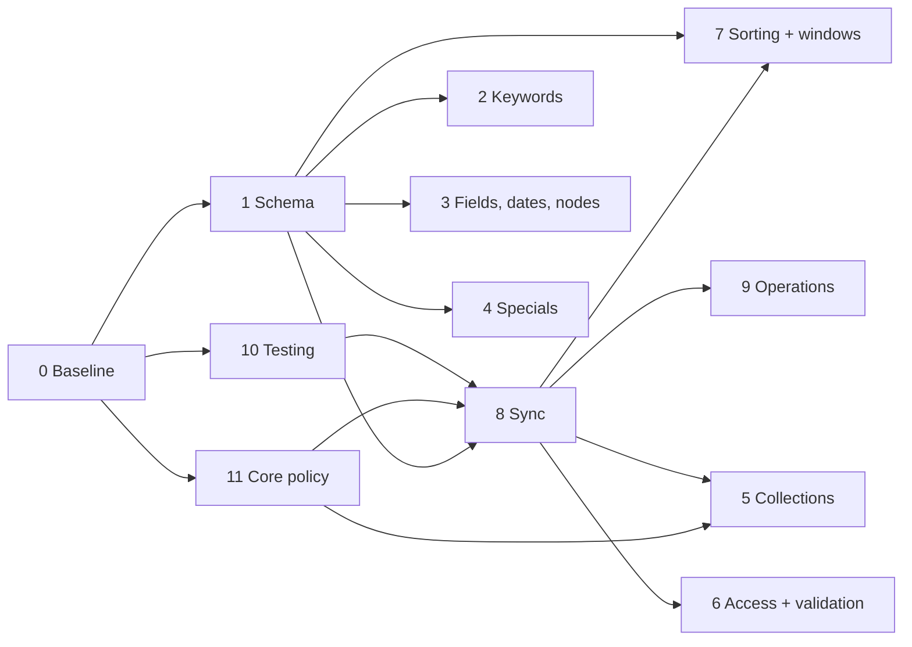

# Typesense search for ResourceSpace — planning

This repository holds the plan for the `typesense_search` ResourceSpace plugin: the work split into
chunks, the questions each chunk needs answered before any code is written, and the decisions as
they are made. The code lives in `cwe/resourcespace` (branch `typesense`, directory
`plugins/typesense_search`). Nothing here is code.

It is a restart. The plugin already serves most searches and a great deal has been learned since
September 2026 (see [state-of-play.md](state-of-play.md)); the point of this repo is to decide,
chunk by chunk, what the plugin should do before changing it further.

## How to use this repo

1. Read [state-of-play.md](state-of-play.md) once — where the code, docs, tests and test systems
   are, and what has been measured.
2. Go through [prior-decisions.md](prior-decisions.md): decisions already taken in earlier sessions.
   Each needs a **confirm** or **revisit** on the restart.
3. Work through the chunks in [chunks/](chunks/). Each file has: scope, what is already known
   (verified facts with pointers), candidate work items, the **questions to answer before coding**,
   dependencies, and what "done" looks like. Question IDs are `Q<chunk>.<n>`.
4. Record every answer in [decisions.md](decisions.md) (date, question ID, decision, reason). Update
   the chunk's status line.
5. A chunk is ready to code when its questions are answered and the chunks it depends on are ready.

[questions.md](questions.md) is a generated index of every question for working through in one
sitting.

## Conventions

- No secrets, host addresses or credentials in this repo. Test-system access details stay in private
  notes.
- References to code use the `cwe/resourcespace` path and, where it matters, the branch or commit.
- Findings are referenced by the numbering in the plugin's own docs (review themes A–H and Core 1–10,
  catalogue rows A1…K4, sync-plan decisions 1–13) so the two repos stay in step.
- Questions are decisions for Chris, not research tasks. Where a question has a recommendation, it is
  marked so; it is still a question.

## The chunks

| # | Chunk | One line | Depends on |
|---|---|---|---|
| 0 | [Baseline, scope and ground rules](chunks/00-baseline-and-ground-rules.md) | What "start again" means, goals, constraints, working practices, where docs live | — |
| 1 | [Index schema and document model](chunks/01-index-schema-and-document-model.md) | What the index holds and how values are represented, cleaned, stemmed and migrated | 0 |
| 2 | [Free-text keyword semantics](chunks/02-free-text-keyword-semantics.md) | AND/OR/NOT, phrases, stop words, prefix, wildcards, typos, synonyms, type-name words | 0, 1 |
| 3 | [Field, date, numeric and node searches](chunks/03-field-date-numeric-and-node-searches.md) | `field:value` in all its forms, dates and ranges, numbers, `@@` nodes and their limits | 0, 1 |
| 4 | [Special searches](chunks/04-special-searches.md) | Which `!` searches to serve, argument parsing, restypes and workflow states on specials | 0, 1 |
| 5 | [Collections](chunks/05-collections.md) | `!collection`, the `J` restriction, memberships, the access gate, hydrated columns | 0, 8, 11 |
| 6 | [Access, permissions and read-time validation](chunks/06-access-permissions-and-validation.md) | Grants, group filters, pending rules, searches used as access gates, stale-index validation | 0, 8 |
| 7 | [Sorting, relevance and result windows](chunks/07-sorting-relevance-and-result-windows.md) | Sort mapping, the relevance model, `fetchrows` shapes, row limits, next/previous | 0, 1 |
| 8 | [Index sync and freshness](chunks/08-index-sync-and-freshness.md) | Hooks, queue, worker, nightly alias rebuild, outage behaviour, the core hooks needed | 0, 1, 11 |
| 9 | [Reindexer, configuration and operations](chunks/09-reindexer-configuration-and-operations.md) | reindex.php, performance, config options, setup page, secrets, deployment, monitoring | 0, 8 |
| 10 | [Testing and verification](chunks/10-testing-and-verification.md) | The local A/B harness, the live API runner, the catalogue, acceptance criteria, test data | 0 |
| 11 | [Core changes and upstream](chunks/11-core-changes-and-upstream.md) | The fork's core patch, hooks and helpers needed in core, core bugs to raise or copy | 0 |

## Suggested order

Proposed: answer chunk 0 first (it settles the policies the others lean on), then get the test
harness into the repo (10) so every later chunk can be verified, settle the core-change policy (11),
then schema (1) and sync (8) — the two foundations everything else rests on — then the search
semantics chunks (2, 3, 4), collections (5), access and validation (6), sorting (7), and operations
(9). The order inside the semantics chunks is itself a question (Q0.10).
